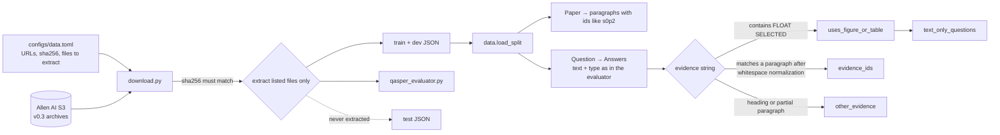

# M0: QASPER download and loader

## Summary
The reflection experiment needs a trustworthy input layer before any model is called. Scores are only
comparable with published QASPER numbers if answers are parsed exactly as the official evaluator parses
them, and retrieval recall is only meaningful if gold evidence maps onto the same paragraphs we retrieve.
M0 adds a checksum-verified download of QASPER v0.3 that never extracts the test split, and a typed
loader. It matches the official evaluator's answer text and type on all 1,005 dev questions, maps 95% of
text evidence to paragraph ids, and filters out the 164 questions that need a figure or table, leaving
841 text-only dev questions.

## How it works

- **Download** (`src/reflective_qa/download.py:21-25`): each archive is fetched to a temp dir, its SHA-256
  checked against the config (`configs/data.toml:7,13`), and only the listed members extracted with
  `filter="data"`. The test archive lists only the evaluator and its README (`configs/data.toml:14`), so
  the test JSON never lands on disk.
- **Paragraphs** (`src/reflective_qa/data.py:80-87`): empty paragraphs are dropped, but ids keep the
  original positions (`s0p2` after a dropped `s0p1`), so ids stay stable across loader changes.
- **Answers** (`src/reflective_qa/data.py:136-146`): same precedence as the evaluator: unanswerable →
  extractive spans joined with ", " → free-form → yes/no. Unanswerable becomes the literal
  `"Unanswerable"` (`data.py:14`), which is what answer-F1 compares against.
- **Evidence** (`src/reflective_qa/data.py:106-117`): figure/table evidence sets a flag; text evidence is
  matched to a paragraph id after collapsing whitespace, or to the one paragraph that contains it
  (`data.py:127-133`); anything else, in practice section headings, is kept in `other_evidence`.
- **Text-only** (`src/reflective_qa/data.py:52`): a question is excluded if *any* annotator used a figure
  or table.

### Dev split (`uv run python -m reflective_qa.stats data/raw/qasper-dev-v0.3.json`)

| | Value |
|---|---|
| Papers / questions | 281 / 1,005 |
| Text-only questions | 841 (616 with ≥2 answers) |
| Answers by type (text-only) | extractive 888 · abstractive 262 · boolean 173 · unanswerable 143 |
| Evidence mapped to paragraphs / not a paragraph | 2,155 / 123 |
| Paragraphs per paper (median) · chars per paragraph (median) | 43 · 412 |

## Decision log

| Decision | Options considered | Chosen | Why | Revisit if |
|---|---|---|---|---|
| Data source | HF `datasets` (loading script, no longer runs in current `datasets`), HF Parquet conversion, original S3 release | Original v0.3 S3 archives | Same files the official evaluator expects; checksummable; no `datasets` dependency | Allen AI moves or retires the S3 bucket |
| Test split | Download and promise not to read it; never extract | Never extract | Makes "test untouched" structural, not a promise. The evaluator ships in the same archive, so only it is extracted | Final evaluation, at the end of Track A |
| Answer parsing | Own rules; copy the evaluator's | Evaluator's precedence, verified on all 1,005 dev questions | Our F1 must equal the official F1 | — |
| Evidence matching | Exact string; whitespace-normalized; fuzzy | Whitespace-normalized, then unique containing paragraph; the rest kept separately | Across all 1,005 dev questions, exact matching missed 206 evidence strings: 77 differ only in whitespace, 3 are part of a paragraph, and 126 are section headings. Headings can't be returned by a paragraph retriever, so they're excluded from recall instead of silently counting as misses | Fuzzy matching becomes necessary for a different dataset |
| Text-only rule | Drop a question if any answer uses a figure/table; only if all do | Any | A question one annotator needed a table for may be unanswerable from text; keeps the eval set clean (QASPER §5 also excludes them) | We want an "unanswerable from text" probe |
| Model layer for M1 | aisuite (course library); Anthropic SDK | Anthropic SDK | Only Anthropic models in scope; direct access to effort, usage and Batch API, which the cost metrics need. Multi-provider councils are Track B | A non-Anthropic critic is added |

## Cost & risk
- **M0 cost:** none. No model calls; about 15 MB of downloads.
- **Prices checked (Anthropic first-party, cached 2026-10-06):** Sonnet 5.5 $2 / $10 per million input /
  output tokens; Haiku 5.5 $0.10 / $0.50; Haiku 4.5 $1 / $5. Batch API is 50% off.
- **Estimate for M1–M4 (not measured):** about 2,800 calls, about 5M input and 1.4M output tokens
  including thinking. That assumes 10 retrieved paragraphs per call at about 100 tokens each (412 chars ÷ 4);
  100 questions × 3 baseline runs in M1; about 500 critic-tuning calls in M3; 5 setups × 100 questions ×
  about 4 calls in M4. All on Sonnet 5.5: about $24; all on Haiku 5.5: about $1. Batch halves either. M1
  replaces this with `count_tokens` and measured usage.
- **Risks:**
  - The S3 URLs could disappear. The checksums in `configs/data.toml` detect any change.
  - The QASPER papers (arXiv up to about 2020) are almost certainly in the models' training data. M1's
    closed-book run measures how much.
  - About 24% of individual gold answers are wrong (QASPER §3). Answer-F1 is a signal, not ground truth,
    until M2 labels exist.
- **Rollback:** delete `data/`; `python -m reflective_qa.download` rebuilds it.

## Open questions
1. **API key or subscription.** A proxy that reuses Max credentials as an API endpoint conflicts with
   Anthropic's
   [credential policy](https://code.claude.com/docs/en/legal-and-compliance) and risks the account.
   Running the unmodified `claude -p` under your own login is permitted, but it uses your Max limits,
   adds Claude Code's system prompt, and wouldn't be reproducible for anyone else. Recommendation: an
   API key for M1 onward.
2. **Weak writer model.** The approved plan named Haiku 4.5. Haiku 5.5 is current, 10× cheaper, and
   probably stronger. Recommendation: Haiku 5.5, made "weak" by giving it fewer passages, rather than
   paying more for an older model.
3. **k for retrieval:** decided in M1 from evidence recall@k on the 2,155 mapped evidence paragraphs.
