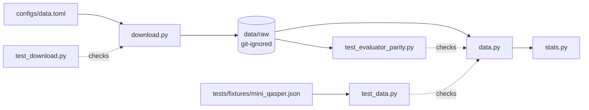

# M0: QASPER download and loader

## Summary
The reflection experiment needs a trustworthy input layer before any model is called. Answer-F1 is only
correct if answers are parsed exactly as the official evaluator parses them, and retrieval recall is only
meaningful if gold evidence maps onto the same paragraphs we retrieve.
M0 adds a checksum-verified download of QASPER v0.3 that never extracts the test split, and a typed
loader. It matches the official evaluator's answer text and type on all 1,005 dev questions, maps 95% of
text evidence to paragraph ids, and filters out the 164 questions that need a figure or table, leaving
841 text-only dev questions.

## How it works

- **Download** (`src/reflective_qa/download.py:22-34`): each archive is fetched into a temp dir inside
  `data/raw`, its SHA-256 checked against the config (`configs/data.toml:7,13`), only the listed members
  extracted with `filter="data"`, then renamed into place, so an interrupted run leaves no partial files. The test archive lists only the evaluator and its README (`configs/data.toml:14`), so
  the test JSON never lands on disk.
- **Paragraphs** (`src/reflective_qa/data.py:80-90`): empty paragraphs and repeats of an earlier paragraph
  are dropped (dev has 73 repeats, such as "Attention only: 1"), so each evidence text has exactly one id
  to retrieve. Ids keep the original positions (`s0p2` after a dropped `s0p1`).
- **Answers** (`src/reflective_qa/data.py:130-140`): same precedence as the evaluator: unanswerable →
  extractive spans joined with ", " → free-form → yes/no. Unanswerable becomes the literal
  `"Unanswerable"` (`data.py:14`), which is what answer-F1 compares against.
- **Evidence** (`src/reflective_qa/data.py:109-120`): figure/table evidence sets a flag; text evidence is
  matched to a paragraph id after collapsing whitespace; anything else is kept in `other_evidence`. On
  dev, everything in `other_evidence` is a section heading.
- **Text-only** (`src/reflective_qa/data.py:52`): a question is excluded if *any* annotator used a figure
  or table.

### Dev split (`uv run python -m reflective_qa.stats data/raw/qasper-dev-v0.3.json`)

| | Value |
|---|---|
| Papers / questions | 281 / 1,005 |
| Text-only questions | 841 (616 with ≥2 answers) |
| Answers by type (text-only) | extractive 888 · abstractive 262 · boolean 173 · unanswerable 143 |
| Evidence mapped to paragraphs / section headings | 2,154 / 124 |
| Paragraphs per paper (median) · chars per paragraph (median) | 43 · 415 |

## Files in this PR

How the files depend on each other: the config drives the download, the loader reads what the download
wrote, and each test pins one guarantee.

### The package: `src/reflective_qa/`

| File | What it is | Why it's in this PR |
|---|---|---|
| `data.py` | Typed records (`Paragraph`, `Answer`, `Question`, `Paper`, `data.py:27-63`) and `load_split` (`data.py:66`), which parses one released QASPER JSON file | Every later milestone reads data through this one place. Answers are parsed in the official scorer's order (`data.py:130-140`), so our answer-F1 equals the official one. Evidence is mapped to paragraph IDs (`data.py:109-120`), which retrieval recall in M1 needs. `text_only_questions` (`data.py:72`) defines the 841-question working set |
| `download.py` | `download()` (`download.py:15`): fetches the archives listed in the config, checks SHA-256, extracts only listed files | Makes the data reproducible for anyone cloning the public repo, detects a changed or corrupted release, and keeps the test split off disk. Paths resolve from the config file (`download.py:18`), so it works from any directory |
| `stats.py` | `summarize()` (`stats.py:11`): counts papers, questions, answer types and evidence coverage | A one-command check that the loader behaves on real data. Every number in this explainer's dev-split table comes from it |
| `__init__.py` | Package marker with a one-line docstring | Required for `reflective_qa` to be importable. The `hello()` stub `uv init` generated was removed |
| `py.typed` | Empty marker file (PEP 561) | Tells type checkers the package ships type hints. Generated by `uv init --lib`; only matters if another project imports this one, and costs nothing |

### Configuration

| File | What it is | Why it's in this PR |
|---|---|---|
| `configs/data.toml` | Archive URLs, SHA-256 checksums, the files to extract from each, and `raw_dir` (`configs/data.toml:3-14`) | Keeps data sources out of code, per the repo conventions. The checksums are the contract that the data hasn't changed, and the second archive's `extract` list (`:14`) is what keeps the test split off disk |

### Tests: `tests/`

| File | What it is | Why it's in this PR |
|---|---|---|
| `fixtures/mini_qasper.json` | One hand-written paper with four questions | Covers every edge case found in the real data in a file small enough to read: each answer type, an empty paragraph, a repeated paragraph, whitespace-mismatched evidence, a heading that also appears inside a paragraph, and figure evidence |
| `test_data.py` | Six behavior tests of the loader on the fixture (`test_data.py:16-46`) | Pins the loader's guarantees: stable IDs, evaluator-matching answers, evidence mapping, headings kept separate, the text-only rule. Three of them fail on the reviewed version of the loader, so they guard real bugs |
| `test_download.py` | Two tests using local `file://` archives (`test_download.py:31-43`) | Proves the two download guarantees without the network: only listed files are extracted, and a checksum mismatch raises with nothing written |
| `test_evaluator_parity.py` | Compares the loader with `qasper_evaluator.py` on all 1,005 dev questions (`test_evaluator_parity.py:20`) | Turns "matches the official scorer" from a one-off check into a repeatable test. Skipped when the data isn't downloaded (`:15`), so the suite still runs on a fresh clone |

### Project setup

| File | What it is | Why it's in this PR |
|---|---|---|
| `pyproject.toml` | Package metadata; Python ≥ 3.12; no runtime dependencies; pytest as a dev dependency (`pyproject.toml:7-16`) | M0 needs only the standard library (`tomllib`, `tarfile`, `urllib`), so there is nothing to pin or audit yet. The Anthropic SDK arrives with M1 |
| `uv.lock` | Exact versions of every installed package (pytest and its dependencies) | Anyone cloning gets the same environment with `uv sync` |
| `.python-version` | `3.12` | Tells uv which interpreter to use, leaving the system Anaconda 3.8 untouched |
| `.gitignore` | Ignores `data/`, `.env`, `.venv/` and caches | QASPER data is downloaded, not committed. `.env` is listed now so a key added in M1 can't be committed by accident |
| `README.md` | What the project is, milestone status, how to run | The entry point for anyone landing on the public repo |

### Docs: `docs/`

| File | What it is | Why it's in this PR |
|---|---|---|
| `explainers/2026-10-09-m0-data.md` | This document | Explains the why behind M0 for a reader who wasn't in the session |
| `demos/2026-10-09-m0-data/README.md` | What the demo proved, how to reproduce it, expected vs. observed | Evidence that M0 works end to end on a fresh clone, not just in unit tests |
| `demos/2026-10-09-m0-data/transcript.txt` | Raw output of the demo run | The captured proof behind the demo README. Local paths and the username are stripped |

## Decision log

| Decision | Options considered | Chosen | Why | Revisit if |
|---|---|---|---|---|
| Data source | HF `datasets` (loading script, no longer runs in current `datasets`), HF Parquet conversion, original S3 release | Original v0.3 S3 archives | Same files the official evaluator expects; checksummable; no `datasets` dependency | Allen AI moves or retires the S3 bucket |
| Test split | Download and promise not to read it; never extract | Never extract | Makes "test untouched" structural, not a promise. The evaluator ships in the same archive, so only it is extracted | Final evaluation, at the end of Track A |
| Answer parsing | Own rules; copy the evaluator's | Evaluator's precedence, verified on all 1,005 dev questions | Our F1 must equal the official F1 | — |
| Evidence matching | Exact string; whitespace-normalized; fuzzy | Whitespace-normalized exact match; the rest kept separately | Across all 1,005 dev questions, exact matching missed 206 evidence strings: 77 differ only in whitespace and 129 are section headings. Headings can't be returned by a paragraph retriever, so they're excluded from recall instead of silently counting as misses. A "paragraph containing the evidence" fallback was tried and removed: on dev and train it only ever matched headings, to the wrong paragraph | A dataset whose evidence is sentence-level |
| Text-only rule | Drop a question if any answer uses a figure/table; only if all do | Any | A question one annotator needed a table for may be unanswerable from text; keeps the eval set clean. The official evaluator never drops questions and scores a missing prediction as 0, so M1 must score against a gold file filtered to the same 841 questions | We want an "unanswerable from text" probe |
| Runtime dependencies | `requests`, `datasets`, standard library | Standard library only | `tomllib`, `tarfile` and `urllib` cover config, extraction and download; nothing to pin or audit | M1 adds the Anthropic SDK and a BM25 library |
| `.env.example` | Add now; add with the API layer | With the API layer (M1) | Nothing in M0 reads a key, and how models are accessed is still open | — |
| Model layer for M1 | aisuite (course library); Anthropic SDK | Anthropic SDK | Only Anthropic models in scope; direct access to effort, usage and Batch API, which the cost metrics need. Multi-provider councils are Track B | A non-Anthropic critic is added |

## Cost & risk
- **M0 cost:** none. No model calls; about 15 MB of downloads.
- **Prices checked (Anthropic first-party, cached 2026-10-06):** Sonnet 5.5 $2 / $10 per million input /
  output tokens; Haiku 5.5 $0.10 / $0.50; Haiku 4.5 $1 / $5. Batch API is 50% off.
- **Estimate for M1–M4 (not measured):** about 2,800 calls, about 5M input and 1.4M output tokens
  including thinking. That assumes 10 retrieved paragraphs per call at about 100 tokens each (412 chars ÷ 4);
  100 questions × 3 baseline runs in M1; about 500 critic-tuning calls in M3; 5 setups × 100 questions ×
  about 4 calls in M4. All on Sonnet 5.5: about $24; all on Haiku 5.5: about $1. Batch halves either. M1
  replaces this with `count_tokens` and measured usage.
- **Risks:**
  - The S3 URLs could disappear. The checksums in `configs/data.toml` detect any change.
  - The QASPER papers (arXiv up to about 2020) are almost certainly in the models' training data. M1's
    closed-book run measures how much.
  - About 24% of individual gold answers are wrong (QASPER §3). Answer-F1 is a signal, not ground truth,
    until M2 labels exist.
- **Rollback:** delete `data/`; `uv run python -m reflective_qa.download` rebuilds it.

## Open questions
1. **API key or subscription.** A proxy that reuses Max credentials as an API endpoint conflicts with
   Anthropic's
   [credential policy](https://code.claude.com/docs/en/legal-and-compliance) and risks the account.
   Running the unmodified `claude -p` under your own login is permitted, but it uses your Max limits,
   adds Claude Code's system prompt, and wouldn't be reproducible for anyone else. Recommendation: an
   API key for M1 onward.
2. **Weak writer model.** The approved plan named Haiku 4.5. Haiku 5.5 is current, 10× cheaper, and
   probably stronger. Recommendation: Haiku 5.5, made "weak" by giving it fewer passages, rather than
   paying more for an older model.
3. **k for retrieval:** decided in M1 from evidence recall@k on the 2,154 mapped evidence paragraphs.
